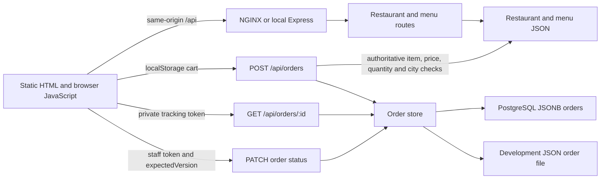

# CloudBite debugging audit

Date: 2026-10-20. Branch: `debug/reproducible-bug-audit`. Starting commit: `a55e404` plus the user's existing uncommitted changes.

Ten likely bug sources were selected from a repository-wide architecture review and reproduced with eleven failing tests before application changes. One source has separate frontend and backend reproductions. All ten received focused fixes; existing tests were retained. Final validation passed all 66 tests with no failures or skips, including real PostgreSQL recovery. The pre-existing suite passed 55 tests, demonstrating gaps in its coverage rather than an already-failing baseline.

## Architecture and inspection scope

| Area | Files inspected / responsibility |
| --- | --- |
| Frontend | All five `client/*.html` pages, `client/js/*.js`, and relevant stylesheet rules. Plain browser JavaScript renders restaurant/menu cards, stores carts and customer tracking access in localStorage, and keeps staff tokens in sessionStorage. |
| API | `server/server.js`, all three route modules, and validation utilities. Express serves the local frontend, parses requests, exposes catalog/order APIs, and centralizes errors. |
| Catalog | `server/data/restaurants.json` and `menu.json`: 100 restaurants and 1,957 dishes with no duplicate IDs in the checked-in snapshot. Both Python CSV importers and catalog documentation were reviewed. CSVs feed generation scripts, not live application requests. |
| Persistence | Both order-store adapters and conflict helpers. Orders use PostgreSQL when configured, otherwise a single-process atomic JSON store for development. PostgreSQL stores each order as JSONB in `cloudbite_orders`; uniqueness enforces checkout replay keys and SQL version checks protect concurrent updates. |
| Delivery | `Jenkinsfile`, Dockerfiles, Compose overlays, NGINX configuration, deployment shell script, Kubernetes Deployments/Services/ConfigMap/PostgreSQL StatefulSet. Jenkins scans both image references before passing them to deployment. |
| Monitoring | Prometheus/Blackbox configurations, Kubernetes monitoring manifests/RBAC, Grafana provisioning and dashboard JSON. Monitoring probes service availability; it does not validate checkout semantics. |
| Tests/documentation | Existing API, frontend, checkout recovery, security, and chaos suites; requirements, tracking, architecture, configuration, and operational guides. Existing working-tree changes were identified before editing. |

### Frontend → backend → database paths



PostgreSQL and JSON are alternative adapters, not simultaneous writes. Rejected checkout requests must fail before invoking either adapter. Catalog reads do not query the order database. Search merges restaurant metadata with dish matches; frontend filters must use the same meaning as backend filters. Order lookups are asynchronous and require request-local state to associate returned data and tracking credentials correctly.

## Reproduction and test execution

```bash
# Full suite, including real local PostgreSQL chaos tests when binaries are present
npm test

# All eleven audit reproductions (ten underlying bug sources)
node --test test/debug-audit.test.js

# One reproduction, for example duplicate quantities
node --test --test-name-pattern='D01:' test/debug-audit.test.js

npm run check
```

Tests use synthetic customer details and temporary order files. Catalog faults intercept reads only inside the audit test's Node process; they never overwrite the repository's catalog or development order data. Frontend tests execute the actual scripts using a small VM/DOM/storage adapter. Network tests listen only on ephemeral loopback ports. Existing chaos tests create their own private local PostgreSQL cluster; no existing cluster or deployment is targeted. PostgreSQL binaries default to `/usr/lib/postgresql/16/bin`; `CHAOS_PG_BIN` can override that directory. Missing binaries cause the existing real-PostgreSQL test to explicitly skip.

Evidence: [existing baseline](docs/bug-evidence/baseline.tap) and [eleven failing reproductions before fixes](docs/bug-evidence/reproductions-before.tap). The baseline ran before implementation edits; no original tests failed. The reproduction log intentionally contains failing assertions and is retained as evidence, not included as an executable test file.

## Ten confirmed bugs

### D01 — Medium: duplicate rows bypass the quantity limit

**Source/root cause:** `server/routes/orderRoutes.js` validated each cart row independently. Numeric ID `1` and string ID `"1"` resolve to the same menu item, but two rows of 50 each passed the per-row check.

**Reproduction:** POST an order containing the first catalog item twice, once with its numeric ID and once with its string ID, each at quantity 50. Before the fix, HTTP 201 persisted an order totaling 100 units of one dish.

**Fix:** aggregate quantities by the validated canonical item ID before enforcing the 50-unit limit. Existing price/availability checks remain authoritative. Duplicate rows whose combined quantity is at most 50 remain supported.

**Evidence:** D01 in [before](docs/bug-evidence/reproductions-before.tap) and [after](docs/bug-evidence/after-D01.tap). The rejected request now returns 400 and leaves zero orders; two rows of 25 still return 201. This check precedes both storage adapters.

### D02 — Medium: one delivery calculation accepts different cities

**Source/root cause:** checkout read menu items but did not resolve their parent restaurants. It calculated one delivery fee solely from the subtotal, regardless of outlet city.

**Reproduction:** select an item from the first restaurant and another from a restaurant in a different city. Submit one order. Before the fix, HTTP 201 persisted the mixed-city order.

**Fix:** resolve outlet identities from the server restaurant catalog, normalize their cities, and reject a cart spanning more than one city with 400. Missing restaurant/location data fails with 503. Same-city orders spanning different outlets retain their previous behavior.

**Evidence:** D02 [before](docs/bug-evidence/reproductions-before.tap), [after](docs/bug-evidence/after-D02.tap). The invalid cart leaves storage empty; a same-city, two-outlet cart still returns 201. This enforces the existing city rule; it does not implement GPS distance filtering.

### D03 — Medium: the American / Fast Food chip excludes Fast Food

**Source/root cause:** the visible chip in `client/restaurants.html` advertised “American / Fast Food” but sent `data-cuisine="American"`. Both filtering implementations correctly searched the supplied text, therefore excluding the catalog's Fast Food restaurants.

**Reproduction:** extract the actual chip's value from HTML and pass it to the real frontend filter and restaurant API. Before the fix, the frontend returned zero matches instead of the 13 advertised-cuisine matches. A direct `Fast Food` query already worked; this was not evidence for rewriting generic cuisine normalization.

**Fix:** the chip now sends `American / Fast Food`, explicitly interpreted as either advertised cuisine by both the frontend and backend. Existing single-cuisine filters keep their behavior.

**Evidence:** D03 [before](docs/bug-evidence/reproductions-before.tap), [after](docs/bug-evidence/after-D03.tap). Both layers now return the expected catalog IDs, and the existing cuisine/search tests pass.

### D04 — Medium: unknown-city URLs broaden to the entire catalog

**Source/root cause:** `populateCityOptions()` replaced every city not found in the catalog with an empty string. The empty string means “All cities,” silently changing the user's requested location.

**Reproduction:** initialize the city filter with `Unknown-City-For-Reproduction`, then populate the selector. Before the fix, filtering returned all 100 restaurants.

**Fix:** keep an unknown requested city selected as an explicit unavailable option. Its exact city filter yields the normal empty-results state; known city aliases differing only in case still resolve to the canonical option.

**Evidence:** D04 [before](docs/bug-evidence/reproductions-before.tap), [after](docs/bug-evidence/after-D04.tap). Unknown city returns zero and stays selected; `hyderabad` still becomes `Hyderabad`. The backend already filtered unknown cities correctly and was left unchanged for this bug.

### D05 — Medium: older lookups overwrite newer Orders state

**Source/root cause:** `fetchOrders()` used mutable global lookup/mode state after asynchronous requests and allowed every response to update the same DOM. An older success could render alongside a newer authorization error. The same mutable ID was used when saving entered tracking credentials, risking association with a later lookup.

**Reproduction:** start `ORDOLD`, start `ORDNEW`, resolve `ORDNEW` with 403, then resolve `ORDOLD` with success. Before the fix, an old order card appeared while the newer error remained displayed.

**Fix:** capture lookup ID and mode for each request; increment a request sequence; ignore superseded responses, parsed bodies, aggregate history results, and failures before they change UI/storage state. The latest request owns the loader, results, and error state.

**Evidence:** D05 [before](docs/bug-evidence/reproductions-before.tap), [after](docs/bug-evidence/after-D05.tap). The newer error remains, old cards do not render, and no stale tracking access is saved. Existing manual tracking and privacy tests pass.

### D06 — Medium: blocked session storage breaks Orders initialization

**Source/root cause:** `getAdminToken()` and `setAdminToken()` accessed sessionStorage without handling browser storage exceptions. Orders initialization called the getter before entering its network error handler. Staff entry also enabled staff mode without checking whether the credential could be saved.

**Reproduction:** provide sessionStorage methods that throw `SecurityError`; call `initOrdersPage()` and enter a staff token. Before the fix, initialization threw instead of displaying a usable customer Orders page.

**Fix:** storage reads fail to an empty token; writes/removals return an explicit success boolean. Staff entry verifies persistence and reports failure without activating staff mode. This is localized failure handling, not a replacement authentication system.

**Evidence:** D06 [before](docs/bug-evidence/reproductions-before.tap), [after](docs/bug-evidence/after-D06.tap). Initialization, reads, writes, and staff entry tolerate the failure; staff mode remains false. Existing checkout tracking recovery tests pass.

### D07 — Medium: unavailable dishes have enabled Add controls

**Source/root cause:** menu rendering always created an enabled Add button. The shared `addToCart()` helper also ignored the item's availability. The backend rejected unavailable dishes later, leaving a misleading cart/UI path.

**Reproduction:** render a menu record with `isAvailable: false`. Before the fix its Add button was enabled. The audit also dispatches its handler and directly calls the shared cart helper.

**Fix:** mark the button disabled, label it “Unavailable,” expose `aria-disabled`, and guard both the handler and the shared cart entry point. Server-side availability validation is retained.

**Evidence:** D07 [before](docs/bug-evidence/reproductions-before.tap), [after](docs/bug-evidence/after-D07.tap). Neither interaction adds the unavailable dish; an available dish can still be added. No order-store change was necessary.

### D08 — Medium: menu failures silently produce incomplete search results

**Source/root cause:** the backend caught menu read failures and searched only restaurant metadata. The frontend similarly ignored failed menu requests, then reported the reduced results with its normal success count. A dependency failure was indistinguishable from genuinely absent dishes.

**Reproduction:** inject corrupt menu JSON into the backend search read. Separately return 503 from the frontend's menu request while restaurants load successfully. Before the fix, the backend returned 200 with partial data and the frontend displayed an ordinary successful result count.

**Fix:** backend dish search returns 503 when its menu dependency fails. Frontend tracks whether dish data loaded, clears stale dish data before retry, and shows a retryable unavailable-search state when searching without it. Restaurant browsing without a search remains available, labeled with the dish-search limitation.

**Evidence:** both D08 tests [before](docs/bug-evidence/reproductions-before.tap), [after](docs/bug-evidence/after-D08.tap). Backend status is 503; frontend failure is visible instead of presenting a partial set as complete. Normal search/filter tests still pass.

### D09 — Medium: invalid catalogs return success or inconsistent errors

**Source/root cause:** catalog helpers parsed JSON without validating its shape. Missing/blank files were treated as empty arrays. Unfiltered endpoints could return `success: true` for `{}`, while filtered/detail endpoints crashed when invoking array/string methods on invalid values. Checkout had a separate, weaker array-only validator.

**Reproduction:** inject `{}`, `null`, `[null]`, and `[{"id":1}]` for menu reads, exercising listing, search, item details, restaurant menus, and checkout; inject an incomplete restaurant record. Before the fix, `/api/menu` with `{}` returned HTTP 200 and `success: true`.

**Fix:** use one catalog reader that validates array shape, record identity, unique positive integer IDs, menu parent IDs/prices, and relevant string/availability fields. Fail closed with 503 across callers. Optional menu description/category fields are handled safely when absent. Checkout still rejects missing parent/location data. This does not claim atomic publication or stable IDs across regeneration.

**Evidence:** D09 [before](docs/bug-evidence/reproductions-before.tap), [after](docs/bug-evidence/after-D09.tap). All injected malformed cases return 503 with `success: false`; checkout writes nothing; removing the fault restores normal catalog success. The user's existing CRLF formatting in `menuRoutes.js` was retained while replacing its reader.

### D10 — High: Jenkins branch jobs can overwrite scanned image tags

**Source/root cause:** backend/frontend image tags used only `BUILD_NUMBER`. Independent branch jobs sharing a Docker host can have the same number. Serializing builds of one job does not give different jobs distinct image names; the scanned reference could therefore identify another job's image before deployment.

**Reproduction:** evaluate the pipeline's backend and frontend tag expressions for `cloudbite/main` build 42 and `cloudbite/feature/api` build 42. Before the fix both produced `cloudbite-backend:42` and `cloudbite-frontend:42`.

**Fix:** `scripts/image-tags.js` builds valid references from a SHA-256 namespace of controller URL/job name, build number, and commit prefix; invalid/missing release inputs stop tag generation. Jenkins uses those same references for build, scan, and deployment. No Docker daemon, registry, or deployment was modified for this demonstration.

**Evidence:** D10 [before](docs/bug-evidence/reproductions-before.tap), [after](docs/bug-evidence/after-D10.tap). The test executes the configured helper for two jobs with identical build/commit values, checks noncollision across jobs/builds, and checks Docker tag syntax. Actual parallel Jenkins execution remains unverified.

## Regression checks after every fix

Each row includes all 43 existing application/API/security/checkout tests plus every repaired audit reproduction so far. Known unfixed reproductions were excluded by positive test-name selection until their fixes were applied. The full existing chaos suite ran before implementation and is included again in final validation. An initial negative-name filter accidentally selected the known unfixed tests; that run was inspected, the selector corrected, and D01's regression rerun successfully before applying D02. No failing test or assertion was removed to obtain a pass.

| Fix just applied | Tests passed | Failures | Evidence |
| --- | --- | --- | --- |
| D01 | 44 | 0 | [Run evidence](docs/bug-evidence/after-D01.tap) |
| D02 | 45 | 0 | [Run evidence](docs/bug-evidence/after-D02.tap) |
| D03 | 46 | 0 | [Run evidence](docs/bug-evidence/after-D03.tap) |
| D04 | 47 | 0 | [Run evidence](docs/bug-evidence/after-D04.tap) |
| D05 | 48 | 0 | [Run evidence](docs/bug-evidence/after-D05.tap) |
| D06 | 49 | 0 | [Run evidence](docs/bug-evidence/after-D06.tap) |
| D07 | 50 | 0 | [Run evidence](docs/bug-evidence/after-D07.tap) |
| D08 | 52 | 0 | [Run evidence](docs/bug-evidence/after-D08.tap) |
| D09 | 53 | 0 | [Run evidence](docs/bug-evidence/after-D09.tap) |
| D10 | 54 | 0 | [Run evidence](docs/bug-evidence/after-D10.tap) |
## Final validation

The complete final run is recorded in [final test evidence](docs/bug-evidence/final.tap). [Syntax/static evidence](docs/bug-evidence/syntax.txt) records JavaScript checking and additional configuration parsing. All **66 tests passed**, with **0 failures and 0 skips**, in **279.3 seconds**. JavaScript syntax checks passed for **29 files**. Both Python importers, the deployment shell script, and deployment/monitoring YAML and JSON parsed successfully. Expected error messages in the test output come from deliberate fault injection, not failed assertions.

No broad rewrite, dataset regeneration, order-history cleanup, or deployment was performed. Existing private development orders were neither changed nor copied into evidence. Unrelated pre-existing modifications and the notebook deletion remain as they were at intake. The only pre-existing modified source file touched by this audit was `server/routes/menuRoutes.js`, to adopt the shared catalog reader; its existing line-ending style was preserved.

## Limits and remaining review concerns

- The ten selected sources are not an assertion that no other bugs exist. Dataset regeneration still allocates sequential IDs and publishes restaurant/menu files separately; ID stability and atomic publication need separate reproductions and migration design before changes. Metadata enrichment and ambiguous variants remain in the existing tracker.
- GPS distance filtering and dish image enrichment are requested features, not implemented by this debugging pass. Cross-city checkout rejection does not establish nearby delivery eligibility.
- Confirmation-dialog focus behavior and quantity-control focus restoration remain in the existing accessibility backlog. The VM tests are not full-browser accessibility or visual checks.
- Legacy checkout without idempotency keys and unversioned status writes retain the previously documented limits. This audit does not change those API compatibility contracts or introduce an identity provider.
- The real database coverage comes from the existing isolated PostgreSQL chaos suite. No live Jenkins, Docker build, registry push, Minikube deployment, or production service was exercised. Backend container Node 24 runtime compatibility was not separately executed; local tests use Node 22.
- The static syntax/configuration sweep validates parsing, not the availability of external SonarQube, Jenkins credentials, scanners, Docker, or Kubernetes services.
